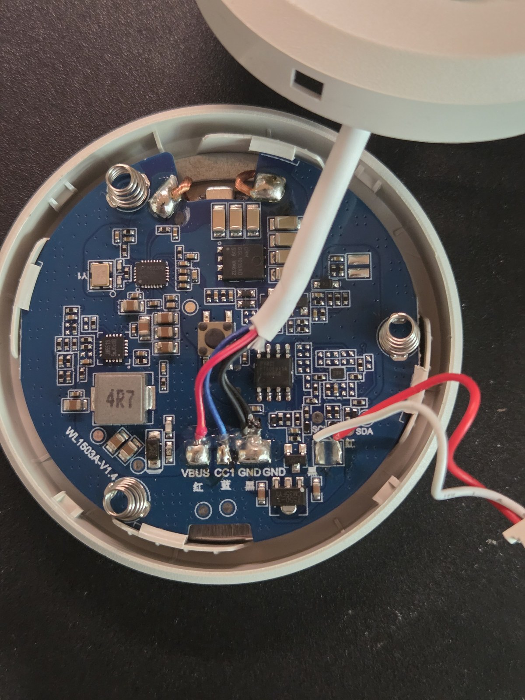
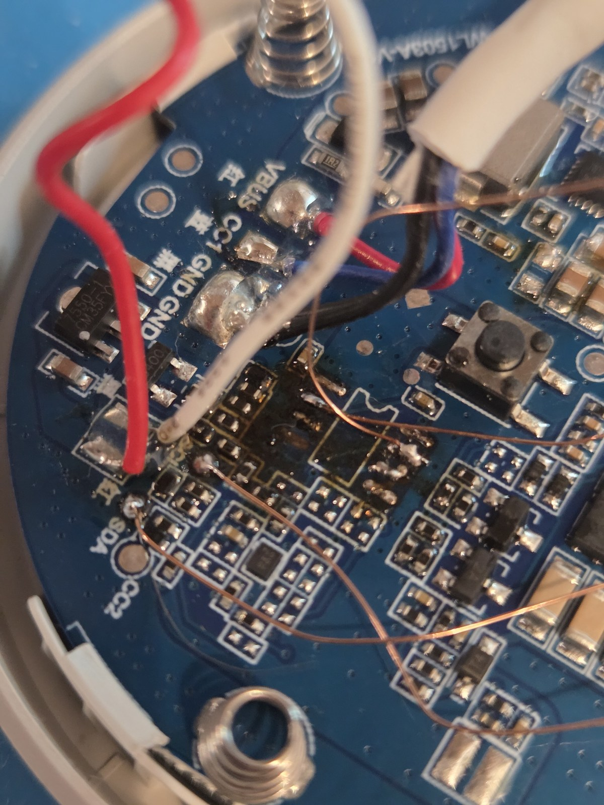
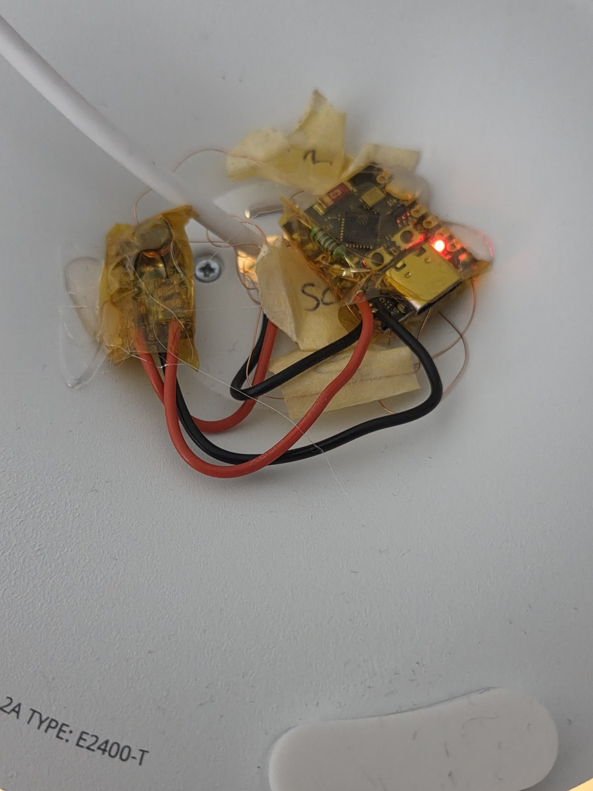

# IKEA VÄSTMÄRKE Qi2 ESPHome Mod

ESP32-C3 mod for the **IKEA VÄSTMÄRKE** Qi2 wireless charging tray with mood lighting (Model `E2400-T`, PCB `WL1503A-V1.4`).

Integrates the LED mood light and the physical puck push button into Home Assistant via ESPHome. The Qi2 15W wireless charging operates autonomously as stock.

  
*Figure 1: Stock IKEA VÄSTMÄRKE PCB (`WL1503A-V1.4`) inside the tray before modification, with original `FT60E011A` MCU installed.*

---

## Features

* **Mood Light Control:** 0–100% smooth PWM dimming via Home Assistant and physical button.
* **Smart Puck Button:** Multi-click actions (single click toggles light, double click fires Home Assistant event, hold dims light).
* **Decoupled Button Mode:** Optional settings switch in Home Assistant to decouple the physical button from the lamp.
* **Autonomous Qi2 Charging:** Qi2 15W MPP fast charging electronics remain untouched and function independently.
* **Invisible Installation:** Both boards fit inside the bottom cavity. The exterior remains completely stock.

---

## Hardware Used

* **IKEA VÄSTMÄRKE** wireless charging tray (`E2400-T`)
* **ESP32-C3 Super Mini**
* **DD4012SA DC-DC buck converter** (configured for 3.3V output)
* Thin hookup wire (AWG 28–32 or enameled copper wire)
* Kapton tape & hot glue

---

## How It Works

The stock PCB uses a Fremont Micro Devices `FT60E011A` (SOP-8) MCU to read the puck button (`SW1`) and switch the LED ring via an `AO3400` N-MOSFET.

By **desoldering the `FT60E011A` MCU**:
1. The 5V pull-up on the button line is removed. Pad 2 connects directly to `SW1` (switching to GND), safely read using the ESP32's internal 3.3V pull-up.
2. Pad 7 connects directly to the gate of the `AO3400` MOSFET, allowing direct 3.3V PWM control from the ESP32.
3. No trace cutting is required.

The `DD4012SA` buck converter steps down the variable `VBUS` (5V standby, 9V during Qi2 USB-PD fast charge) to a steady 3.3V, feeding the ESP32 directly via its `3V3` pin.

---

## Wiring & Solder Points

  
*Figure 2: Real build close-up with `FT60E011A` desoldered. Enameled copper wires connected to Pad 2 (Puck button) and Pad 7 (LED PWM gate). (Note: Power supply wires to VBUS/GND were added in the next step; SDA/SCL wires shown were used during diagnostic I2C testing and are not needed).*

| Signal | Source on IKEA PCB | Destination | Description |
| :--- | :--- | :--- | :--- |
| **Button (`SW1`)** | Desoldered MCU Pad 2 | ESP32 `GPIO 4` | Active-LOW, internal pull-up |
| **LED Gate** | Desoldered MCU Pad 7 | ESP32 `GPIO 5` | Gate of `AO3400` MOSFET |
| **Power Input** | USB-C `VBUS` pad (5V–9V) | DD4012SA `VIN+` | Unregulated input |
| **Power Output**| DD4012SA `VOUT+` (3.3V) | ESP32 `3V3` | Regulated 3.3V rail |
| **Ground** | IKEA `GND` pad | DD4012SA `GND` & ESP32 `GND` | Common ground |

---

## Installation Steps

> [!IMPORTANT]
> **Assembly Order:** Solder flying wire leads to the IKEA stock board **first**, then route them through the USB cable channel and reassemble the internal tray. Only **after** the tray is closed do you solder the wires to the ESP32 and DD4012SA in the bottom cavity.

1. **Flash Firmware:** Flash the ESP32-C3 via USB before installing (see [ESPHome Config](#esphome-config)).
2. **Disassemble:** Remove the screws on the bottom of the tray. Carefully lift the coil assembly (watch out for the three puck springs under the button).
3. **Desolder MCU:** Desolder and remove the 8-pin `FT60E011A` chip next to the button. Clean pads with solder wick.
4. **Solder Leads to Stock PCB:**
   Cut 4 thin wires (AWG 28–32 or enameled copper wire, ~8–10 cm long) and solder them to the stock PCB:
   * **MCU Pad 2** (Puck button signal)
   * **MCU Pad 7** (LED MOSFET gate)
   * **VBUS pad** (Power from USB-C, 5V–9V)
   * **GND pad** (Common ground)
   *(Do not attach the ESP32 or buck converter yet!)*

   > [!TIP]
   > If using enameled copper wire or wire of the same color, label the free ends with small masking tape flags (e.g. `2`, `7`, `+`, `-`) before routing so you can easily identify them later.
5. **Route Wires & Reassemble Internal Tray:**
   * Route all 4 wires through the existing USB cable opening to the bottom cavity.
   * Reseat the puck button onto its three springs.
   * Screw the internal tray and coil assembly back together so the upper housing is completely reassembled.
6. **Wire ESP32 & DD4012SA in Bottom Cavity:**
   Now solder the routed leads to the step-down converter and ESP32:
   * Solder the **VBUS lead** to DD4012SA **VIN+**.
   * Solder the **GND lead** to DD4012SA **GND** and bridge to ESP32 **GND**.
   * Solder DD4012SA **VOUT+** (3.3V) to ESP32 **3V3**.
   * Solder the **Pad 2 lead** to ESP32 **GPIO 4**.
   * Solder the **Pad 7 lead** to ESP32 **GPIO 5**.
7. **Secure Boards:**
   * Insulate both boards with Kapton tape.
   * Fix the ESP32-C3 Super Mini and DD4012SA inside the bottom cavity with hot glue (the stiff wires also help hold them securely in position).
   * Note: The bottom cavity remains open as stock for cable management—there is no bottom cover to reattach.

  
*Figure 3: Completed bottom cavity assembly. The DD4012SA buck converter (left) and ESP32-C3 Super Mini (right) are insulated with Kapton tape, wired to the routed leads, and fixed in place with hot glue inside the open cable cavity.*

---

## ESPHome Config

The full configuration is in [`esphome/ikea-vastmarke.yaml`](esphome/ikea-vastmarke.yaml).

### LED Calibration

The LEDs begin conducting at ~20% duty cycle and saturate around 75%. `min_power` and `max_power` map Home Assistant's 1–100% brightness slider across this active range:

```yaml
output:
  - platform: ledc
    pin: GPIO5
    id: led_pwm
    frequency: 600Hz
    min_power: 0.20
    max_power: 0.75
    zero_means_zero: true

light:
  - platform: monochromatic
    name: "Mood Light"
    id: mood_light
    output: led_pwm
    default_transition_length: 400ms
    gamma_correct: 1.8
    restore_mode: RESTORE_DEFAULT_OFF
```

### Button & Event Behavior

All button events (`single_press`, `double_press`, `long_press`) are exposed to Home Assistant via a native `event` entity. A configuration switch allows you to choose whether a single click should toggle the lamp locally:

```yaml
# Exposed to Home Assistant as: event.ikea_vastmarke_button_event
event:
  - platform: template
    name: "Button Event"
    id: puck_event
    event_types:
      - single_press
      - double_press
      - long_press

# Configuration toggle in Home Assistant
switch:
  - platform: template
    name: "Single Click Controls Lamp"
    id: single_click_controls_lamp
    icon: "mdi:lightbulb-auto"
    optimistic: true
    restore_mode: RESTORE_DEFAULT_ON
    entity_category: config

binary_sensor:
  - platform: gpio
    pin:
      number: GPIO4
      mode: INPUT_PULLUP
      inverted: true
    name: "Puck Button"
    id: puck_button
    filters:
      - delayed_on_off: 25ms
    on_multi_click:
      # Single Click: Fires event to HA; toggles lamp if toggle is ON
      - timing:
          - ON for at most 400ms
          - OFF for at least 250ms
        then:
          - event.trigger:
              id: puck_event
              event_type: single_press
          - homeassistant.event:
              event: esphome.ikea_vastmarke_button
              data:
                action: single_click
          - if:
              condition:
                switch.is_on: single_click_controls_lamp
              then:
                - light.toggle: mood_light

      # Double Click: Fires double_press event to Home Assistant
      - timing:
          - ON for at most 400ms
          - OFF for at most 400ms
          - ON for at most 400ms
          - OFF for at least 200ms
        then:
          - event.trigger:
              id: puck_event
              event_type: double_press
          - homeassistant.event:
              event: esphome.ikea_vastmarke_button
              data:
                action: double_click

      # Long Press: Fires long_press event to Home Assistant
      - timing:
          - ON for at least 500ms
        then:
          - event.trigger:
              id: puck_event
              event_type: long_press
          - homeassistant.event:
              event: esphome.ikea_vastmarke_button
              data:
                action: long_press
          - if:
              condition:
                switch.is_on: single_click_controls_lamp
              then:
                - light.dim_relative:
                    id: mood_light
                    relative_brightness: 25%
                    transition_length: 300ms
```

---

## Home Assistant Automations

In Home Assistant, use the native **Event** trigger:

```yaml
# Example: Double-click triggers bedtime scene
alias: "Bedside: Double-click turn off room"
trigger:
  - platform: state
    entity_id: event.ikea_vastmarke_button_event
    to: "double_press"
action:
  - service: light.turn_off
    target:
      area_id: bedroom
```

---

## Image Sources & Attribution

* **Figure 1, Figure 2 & Figure 3 (Physical build photos):** Captured by [@josb25](https://github.com/josb25) during the modification.

---

## License

MIT
