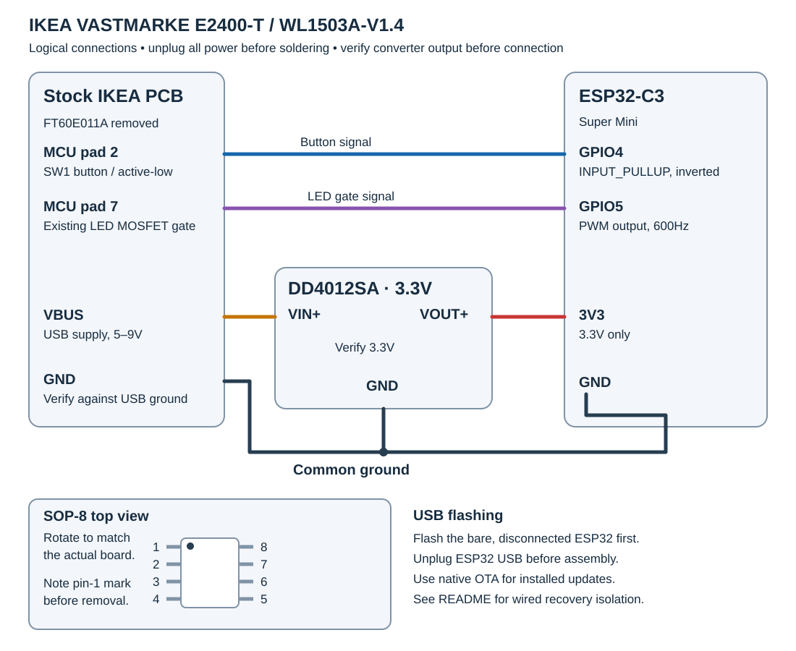

# IKEA VASTMARKE Qi2 ESPHome Mod

ESP32-C3 mod for the **IKEA VASTMARKE** Qi2 wireless charging tray with mood lighting (Model `E2400-T`, PCB `WL1503A-V1.4`).

Integrates the existing light and physical puck push button into Home Assistant via ESPHome. The original Qi2 charging controller is retained and operates independently of this configuration.

This guide covers model `E2400-T`, PCB `WL1503A-V1.4`. Check your product label and PCB revision before following it; other VASTMARKE products are outside its scope. This is an independent hobby modification and is not affiliated with IKEA. Removing the stock MCU requires small-component desoldering skills.

  
*Figure 1: Stock IKEA VASTMARKE PCB (`WL1503A-V1.4`) inside the tray before modification, with original `FT60E011A` MCU installed.*

---

## Features

* **VASTMARKE Light:** PWM brightness control via Home Assistant; the physical button can toggle the light and increase brightness.
* **Smart Puck Button:** Multi-click actions exposing all button events (`single_press`, `double_press`, `long_press`) directly to Home Assistant. By default, single click toggles the light and each long press increases brightness by 25 percentage points once, up to 100%.
* **Decoupled Button Mode:** The "Local Button Controls Lamp" settings switch disables both local toggling and long-press brightening while preserving button events.
* **Independent Charging:** The original Qi2 charging controller is retained. This firmware does not control charging or report charging state/power.
* **Invisible Installation:** Both boards fit inside the bottom cavity. The exterior remains completely stock.

---

## Hardware Used

* **IKEA VASTMARKE** wireless charging tray (`E2400-T`)
* **ESP32-C3 Super Mini**
* **DD4012SA DC-DC buck converter** (**3.3V version** — see caution below!)
* **Hookup wire:**
  * **Data lines (`SW1` & LED gate):** Thin wire (AWG 28–32 or enameled copper wire)
  * **Power lines (`VBUS`, `GND`, `3V3`):** Thicker stranded wire (AWG 22–26, rated for ≥0.5A–1A)
* Kapton tape & hot glue

---

## How It Works

The stock PCB uses a Fremont Micro Devices `FT60E011A` (SOP-8) MCU to read the puck button (`SW1`) and switch the LED ring via an `AO3400` N-MOSFET.

By **desoldering the `FT60E011A` MCU**:
1. The 5V pull-up on the button line is removed. Pad 2 connects directly to `SW1` (switching to GND), safely read using the ESP32's internal 3.3V pull-up.
2. Pad 7 connects directly to the gate of the `AO3400` MOSFET, allowing direct 3.3V PWM control from the ESP32.
3. No trace cutting is required.

The `DD4012SA` buck converter steps down the variable `VBUS` (5V standby, 9V during Qi2 USB-PD fast charge) to a steady 3.3V, feeding the ESP32 directly via its `3V3` pin.

> [!CAUTION]
> **Buck Converter Voltage:** The `DD4012SA` module is manufactured in several fixed-voltage versions (3.3V, 5V, 9V, 12V) or with selectable solder jumpers on the back. You **must use the 3.3V version** (or configure the solder jumper strictly for 3.3V). Feeding 5V or higher directly into the ESP32's `3V3` pin will permanently destroy the ESP32! Always verify the output with a multimeter before wiring it to the ESP32.

---

## Wiring & Solder Points



*Logical connections and top-view SOP-8 pad numbering. Record the stock MCU's pin-1 marker before removal and rotate the pad diagram to match your board. The photos may be rotated relative to this diagram.*

With all power disconnected, verify the selected button pad connects to `SW1`, the LED pad connects to the MOSFET gate, and ground connects to USB ground. Identify the stock PCB's labeled `VBUS` and `GND` points; avoid the diagnostic `SDA`/`SCL` pads. Verify converter polarity and its 3.3V output before connecting the ESP32.

  
*Figure 2: Real build close-up with `FT60E011A` desoldered. Enameled copper wires connected to Pad 2 (Puck button) and Pad 7 (LED PWM gate). (Note: Power supply wires to VBUS/GND were added in the next step; SDA/SCL wires shown were used during diagnostic I2C testing and are not needed).*

| Signal | Source on IKEA PCB | Destination | Recommended Wire | Description |
| :--- | :--- | :--- | :--- | :--- |
| **Button (`SW1`)** | Desoldered MCU Pad 2 | ESP32 `GPIO 4` | AWG 28–32 (thin / enameled) | Active-LOW, internal pull-up (<1 mA) |
| **LED Gate** | Desoldered MCU Pad 7 | ESP32 `GPIO 5` | AWG 28–32 (thin / enameled) | Gate of `AO3400` MOSFET (<1 mA) |
| **Power Input** | USB-C `VBUS` pad (5V–9V) | DD4012SA `VIN+` | AWG 22–26 (stranded power) | Unregulated input (~0.5A peak) |
| **Power Output**| DD4012SA `VOUT+` (3.3V) | ESP32 `3V3` | AWG 22–26 (stranded power) | Regulated 3.3V rail (~0.5A peak) |
| **Ground** | IKEA `GND` pad | DD4012SA `GND` & ESP32 `GND` | AWG 22–26 (stranded power) | Common ground return |

> [!NOTE]
> **Wire Sizing & Amperage:** Thin hookup wire or enameled copper wire is fine for data lines (Pad 2 and Pad 7 draw negligible current, <1 mA). However, the power lines (`VBUS`, `GND`, and the 3.3V link) carry ESP32 WiFi transmission current spikes (~300–500 mA peak). Use thicker stranded wire (AWG 22–26, rated for at least 0.5A–1A) for power and ground to prevent resistive voltage drop and intermittent WiFi brownouts. (You can see the thicker red and black power wires in Figure 3).

---

## Installation Steps

> [!IMPORTANT]
> **Assembly Order:** Solder flying wire leads to the IKEA stock board **first**, then route them through the USB cable channel and reassemble the internal tray. Only **after** the tray is closed do you solder the wires to the ESP32 and DD4012SA in the bottom cavity.

1. **Disassemble:** Disconnect the IKEA USB supply and any ESP32 USB cable. Remove the screws on the bottom of the tray. Carefully lift the coil assembly (watch out for the three puck springs under the button).
2. **Desolder MCU:** Photograph the pin-1 marker and board orientation first. Desolder and remove the 8-pin `FT60E011A` chip next to the button. Clean pads with solder wick.
3. **Solder Leads to Stock PCB:**
   Cut 4 flying wire leads (~8–10 cm long) and solder them to the stock PCB:
   * **MCU Pad 2** (Puck button signal) — thin wire (AWG 28–32 or enameled wire)
   * **MCU Pad 7** (LED MOSFET gate) — thin wire (AWG 28–32 or enameled wire)
   * **VBUS pad** (Power from USB-C, 5V–9V) — thicker power wire (AWG 22–26)
   * **GND pad** (Common ground) — thicker power wire (AWG 22–26)
   *(Do not attach the ESP32 or buck converter yet!)*

> [!TIP]
> **Wire Labeling:** If using enameled copper wire or wires of the same color, label the free ends with small masking tape flags (e.g. `2`, `7`, `+`, `-`) before routing through the hole so you don't mix them up during bottom assembly.

4. **Route Wires & Reassemble Internal Tray:**
   * Route all 4 wires through the existing USB cable opening to the bottom cavity.
   * Reseat the puck button onto its three springs.
   * Screw the internal tray and coil assembly back together so the upper housing is completely reassembled.
5. **Wire ESP32 & DD4012SA in Bottom Cavity:**
   Flash and check the bare ESP32 first using [Initial Setup](#initial-setup), then unplug its USB cable. Verify the converter output is 3.3V with a multimeter, disconnect the IKEA supply again, and solder the routed leads:
   * Solder the **VBUS lead** to DD4012SA **VIN+**.
   * Solder the **GND lead** to DD4012SA **GND** and bridge to ESP32 **GND**.
   * Solder DD4012SA **VOUT+** (3.3V) to ESP32 **3V3**.
   * Solder the **Pad 2 lead** to ESP32 **GPIO 4**.
   * Solder the **Pad 7 lead** to ESP32 **GPIO 5**.
6. **Secure Boards:**
   * Insulate both boards with Kapton tape.
   * Fix the ESP32-C3 Super Mini and DD4012SA inside the bottom cavity with hot glue (the stiff wires also help hold them securely in position).
   * **USB-C Accessibility:** Ensure you orient the ESP32 so its USB-C port faces outward and is not blocked by glue.
   * Note: The bottom cavity remains open as stock for cable management—there is no bottom cover to reattach.
7. **Power & Check:**
   * With the ESP32 USB cable unplugged, power the assembled tray from its normal IKEA USB supply and check Wi-Fi, the light, and the button events.
   * Use native ESPHome OTA for subsequent updates. For USB recovery, disconnect the ESP32 from the converter and stock PCB before plugging it into USB, or use a verified isolation arrangement for your exact boards.

> [!CAUTION]
> **USB and External 3.3V:** The converter feeds the ESP32's `3V3` rail, which can also be powered by the board's USB regulator. Do not connect USB to the wired assembly unless the power circuits and reverse-current isolation of your exact boards have been verified. Unplugging the IKEA supply alone does not establish isolation. Initial flashing should use the bare, disconnected ESP32.

  
*Figure 3: Completed bottom cavity assembly. The DD4012SA buck converter (left) and ESP32-C3 Super Mini (right) are insulated with Kapton tape, wired to the routed leads, and fixed in place with hot glue inside the open cable cavity.*

---

## ESPHome Config

The full configuration is in [`esphome/ikea-vastmarke.yaml`](esphome/ikea-vastmarke.yaml).

### Initial Setup

The configuration is validated against **ESPHome 2026.9.1**. See the [official ESPHome installation guide](https://esphome.io/install/) for Device Builder or CLI installation.

1. Copy `esphome/secrets.yaml.example` to `esphome/secrets.yaml`, beside the device YAML. Replace every placeholder with your own credentials, including unique fallback AP, OTA, and web passwords. The real secrets file is ignored by Git.
2. Generate a fresh API encryption key encoding 32 random bytes:

   ```sh
   python -c "import base64,secrets; print(base64.b64encode(secrets.token_bytes(32)).decode())"
   ```

   Paste it into `api_encryption_key` in your local secrets file. The placeholder is not a valid key.
3. In ESPHome Device Builder, use the device YAML and secrets together and select initial USB installation. For CLI users, run these commands from the repository root:

   ```sh
   python -m pip install esphome==2026.9.1
   esphome config esphome/ikea-vastmarke.yaml
   esphome compile esphome/ikea-vastmarke.yaml
   esphome run esphome/ikea-vastmarke.yaml
   ```

   Connect only the bare ESP32 to a USB data cable for the initial upload and select its serial port. If it needs bootloader recovery, hold **BOOT**, press and release **RESET**, then release **BOOT** and retry the upload. Unplug USB before connecting the converter and stock PCB.
4. Add the device through Home Assistant's **ESPHome** integration using the same API encryption key. Select its actual entity IDs in Home Assistant. The light is named **VASTMARKE Light**.
5. After assembly, use native ESPHome OTA by selecting the device's network address for updates. The password under `ota` protects that native update interface.

### Web Access and Recovery

The normal HTTP interface uses the `web_server_username` and `web_server_password` secrets. Normal web firmware uploads are disabled with `web_server.ota: false`; the native OTA interface remains available.

If Wi-Fi connection fails, the fallback AP and captive portal provide recovery using the unique `fallback_ap_password`. **The active captive portal still supports firmware uploads**; disabling normal web OTA does not remove that recovery feature. Keep its password private. If you do not want captive-portal recovery, remove both `captive_portal` and the `wifi.ap` block. Keep the device on your trusted local network.

### LED Calibration

The LEDs begin conducting at ~20% duty cycle and saturate around 75%. `min_power` and `max_power` map Home Assistant's 1–100% brightness slider across this active range:

```yaml
output:
  - platform: ledc
    pin: GPIO5
    id: led_pwm
    frequency: 600Hz
    min_power: 0.20
    max_power: 0.75
    zero_means_zero: true

light:
  - platform: monochromatic
    name: "VASTMARKE Light"
    id: mood_light
    output: led_pwm
    default_transition_length: 400ms
    gamma_correct: 1.8
    restore_mode: RESTORE_DEFAULT_OFF
```

### Button & Event Behavior

The native **Button Event** entity exposes `single_press`, `double_press`, and `long_press`. The **Local Button Controls Lamp** settings switch controls the local light actions:

| Gesture | Timing | Local action when enabled |
| :--- | :--- | :--- |
| Single press | Press for at most 400ms, then release for at least 450ms | Toggle VASTMARKE Light |
| Double press | Two presses of at most 400ms, separated by at most 400ms, then release for at least 300ms | Emit the event; no local light action |
| Long press | Hold for at least 600ms | Increase brightness by 25 percentage points once, up to 100% |

Single presses wait beyond the double-press gap so one double gesture does not also toggle the light. The input is debounced for 30ms. A press between 400ms and 600ms intentionally has no action. Holding continuously does not repeat brightness steps or reverse their direction.

Disabling local control preserves the button events and disables both local light actions. Local light control runs on the ESP32; Home Assistant must be connected to receive events.

The configuration also emits `esphome.ikea_vastmarke_button` on Home Assistant's event bus with an `action` of `single_click`, `double_click`, or `long_press`. For that additional interface, enable **Allow the device to perform Home Assistant actions** in the device's ESPHome integration options. The native Button Event entity is a separate interface and does not need that option.

### Hardware Verification

Before reproducing the guide on another board, verify the button voltage is safe for the 3.3V input, the converter stays at 3.3V during standby/charging supply transitions, and the added wiring is insulated and clear of the coil, springs, and thermal hardware. Check button gestures, the full brightness range, resets during power negotiation, and sustained charging with Wi-Fi active. Record the exact board revision, software versions, and results when reporting a build.

Configuration validation and compilation check software; they do not verify these physical measurements or a modified charger's charging performance/certification.

### Scope

The stock light is monochromatic. Charging telemetry, power measurement, RGB, and tunable-white control are contributor ideas in the repository's issues, and are not implemented or promised future features of this build.

---

## Image Sources & Attribution

* **Figure 1, Figure 2 & Figure 3 (Physical build photos):** Captured by [@josb25](https://github.com/josb25) during the modification.
* **Wiring diagram:** Original diagram for this guide.
* **Historical diagrams:** Earlier commits include images derived from the internal-photo exhibit for FCC ID `FHO-E2400-T`; current build photos are original. Retain this attribution when reusing historical material.

---

## License

MIT
