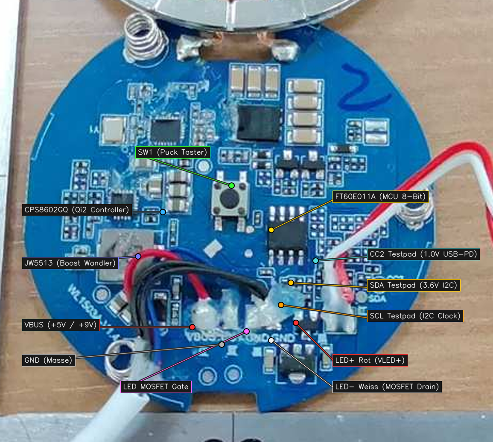
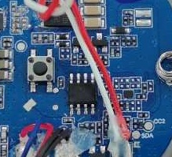
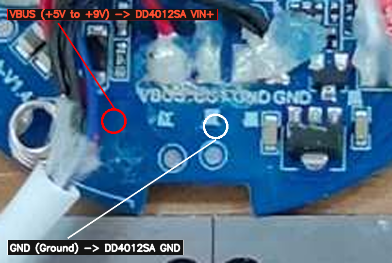

# IKEA VÄSTMÄRKE Qi2 ESPHome Mod

ESP32-C3 mod for the **IKEA VÄSTMÄRKE** Qi2 wireless charging tray with mood lighting (Model `E2400-T`, PCB `WL1503A-V1.4`).

Integrates the LED mood light and the physical puck push button into Home Assistant via ESPHome. The Qi2 15W wireless charging operates autonomously as stock.



---

## Features

* **Mood Light Control:** 0–100% smooth PWM dimming via Home Assistant and physical button.
* **Smart Puck Button:** Multi-click actions (single click toggles light, double click fires Home Assistant event, hold dims light).
* **Autonomous Qi2 Charging:** Qi2 15W MPP fast charging electronics remain untouched and function independently.
* **Invisible Installation:** Both boards fit inside the bottom cavity. The exterior remains completely stock.

---

## Hardware Used

* **IKEA VÄSTMÄRKE** wireless charging tray (`E2400-T`)
* **ESP32-C3 Super Mini**
* **DD4012SA DC-DC buck converter** (configured for 3.3V output)
* Thin hookup wire (AWG 28–32)

---

## How It Works

The stock PCB uses a Fremont Micro Devices `FT60E011A` (SOP-8) MCU to read the puck button (`SW1`) and switch the LED ring via an `AO3400` N-MOSFET.

By **desoldering the `FT60E011A` MCU**:
1. The 5V pull-up on the button line is removed. Pad 2 connects directly to `SW1` (switching to GND), safely read using the ESP32's internal 3.3V pull-up.
2. Pad 7 connects directly to the gate of the `AO3400` MOSFET, allowing direct 3.3V PWM control from the ESP32.
3. No trace cutting is required.

The `DD4012SA` buck converter steps down the variable `VBUS` (5V standby, 9V during Qi2 USB-PD fast charge) to a steady 3.3V, feeding the ESP32 directly via its `3V3` pin.

---

## Wiring & Solder Points





| Signal | Source on IKEA PCB | Destination | Description |
| :--- | :--- | :--- | :--- |
| **Button (`SW1`)** | Desoldered MCU Pad 2 | ESP32 `GPIO 4` | Active-LOW, internal pull-up |
| **LED Gate** | Desoldered MCU Pad 7 | ESP32 `GPIO 5` | Gate of `AO3400` MOSFET |
| **Power Input** | USB-C `VBUS` pad (5V–9V) | DD4012SA `VIN+` | Unregulated input |
| **Power Output**| DD4012SA `VOUT+` (3.3V) | ESP32 `3V3` | Regulated 3.3V rail |
| **Ground** | IKEA `GND` pad | DD4012SA `GND` & ESP32 `GND` | Common ground |

---

## Installation Steps

1. **Flash Firmware:** Flash the ESP32-C3 via USB before installing (see [ESPHome Config](#esphome-config)).
2. **Disassemble:** Remove the rubber base and screws. Carefully lift the coil assembly (watch out for the three puck springs).
3. **Desolder MCU:** Desolder and remove the 8-pin `FT60E011A` chip next to the button. Clean pads with solder wick.
4. **Solder Wires:**
   * Solder wire from **MCU Pad 2** to ESP32 **GPIO 4**.
   * Solder wire from **MCU Pad 7** to ESP32 **GPIO 5**.
   * Solder wire from **VBUS pad** to DD4012SA **VIN+**.
   * Solder common **GND** to DD4012SA **GND** and ESP32 **GND**.
   * Solder DD4012SA **VOUT+** (3.3V) to ESP32 **3V3**.
5. **Route & Mount:**
   * Route the wires through the existing cable routing opening to the bottom side.
   * Secure the ESP32-C3 Super Mini and DD4012SA inside the bottom cavity using adhesive.
   * Reassemble the tray.

---

## ESPHome Config

The full configuration is in [`esphome/ikea-vastmarke.yaml`](esphome/ikea-vastmarke.yaml).

### LED Calibration

The LEDs begin conducting at ~20% duty cycle and saturate around 75%. `min_power` and `max_power` map Home Assistant's 1–100% brightness slider across this active range:

```yaml
output:
  - platform: ledc
    pin: GPIO5
    id: led_pwm
    frequency: 600Hz
    min_power: 0.20
    max_power: 0.75
    zero_means_zero: true

light:
  - platform: monochromatic
    name: "Mood Light"
    id: mood_light
    output: led_pwm
    default_transition_length: 400ms
    gamma_correct: 1.8
    restore_mode: RESTORE_DEFAULT_OFF
```

### Button Behavior (Single, Double & Long Press)

The physical puck button fires native Home Assistant events (`single_press`, `double_press`, `long_press`) and controls the lamp locally:

```yaml
event:
  - platform: template
    name: "Button Event"
    id: puck_event
    event_types:
      - single_press
      - double_press
      - long_press

binary_sensor:
  - platform: gpio
    pin:
      number: GPIO4
      mode: INPUT_PULLUP
      inverted: true
    name: "Puck Button"
    id: puck_button
    filters:
      - delayed_on_off: 25ms
    on_multi_click:
      # Single Click: Toggle light & fire single_press event
      - timing:
          - ON for at most 400ms
          - OFF for at least 250ms
        then:
          - light.toggle: mood_light
          - event.trigger:
              id: puck_event
              event_type: single_press

      # Double Click: Fire double_press event (e.g. good night routine)
      - timing:
          - ON for at most 400ms
          - OFF for at most 400ms
          - ON for at most 400ms
          - OFF for at least 200ms
        then:
          - event.trigger:
              id: puck_event
              event_type: double_press

      # Long Press: Relative dimming & fire long_press event
      - timing:
          - ON for at least 500ms
        then:
          - light.dim_relative:
              id: mood_light
              relative_brightness: 25%
              transition_length: 300ms
          - event.trigger:
              id: puck_event
              event_type: long_press
```

---

## Home Assistant Automations

In Home Assistant, use the native **Event** trigger:

```yaml
# Example: Double-click triggers bedtime scene
alias: "Bedside: Double-click turn off room"
trigger:
  - platform: state
    entity_id: event.ikea_vastmarke_button_event
    to: "double_press"
action:
  - service: light.turn_off
    target:
      area_id: bedroom
```

---

## License

MIT
